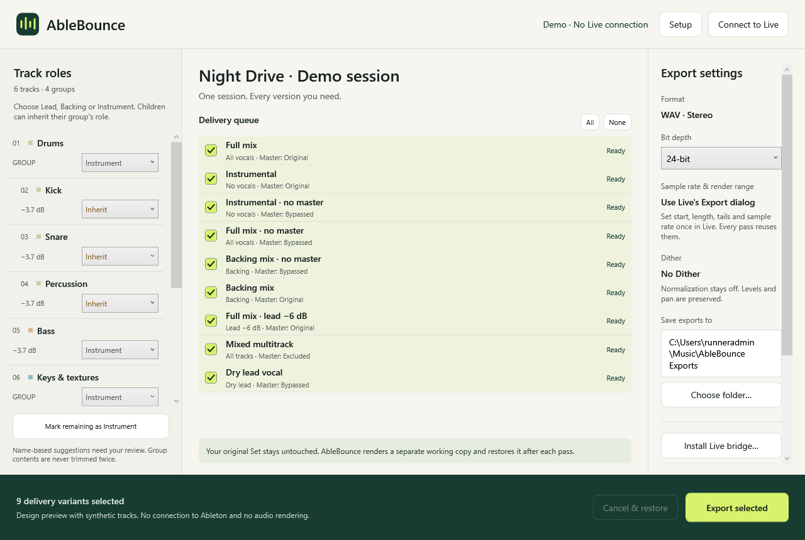

# AbleBounce

A Windows session-delivery companion for **Ableton Live 12.4.x**, with an English
interface. Native Live renders the audio. AbleBounce prepares track/device states,
drives Live's English Export Audio/Video dialog and organises the results.

**Status: 0.1 integration preview.** Bridge state logic has automated regression
coverage. Windows builds and design captures run in GitHub Actions. This project
has not yet been end-to-end tested in a licensed Live 12.4.x installation. A
successful CI build does not establish that the export dialog calibration works
on your machine. Test a short working copy before a full delivery.

## Download

Open [Actions → Build Windows app](https://github.com/RainlineMusic/ablebounce/actions/workflows/windows.yml),
choose a successful run and download one of its artifacts:

- **AbleBounce-Setup-win-x64** — EXE installer, current Windows user only.
- **AbleBounce-portable-win-x64** — self-contained application and instructions.
- **AbleBounce-design-preview** — actual WPF design capture using labelled demo data.

The application includes .NET. No separate Python, Max for Live, virtual MIDI
driver or physical controller is required. Live's built-in Python hosts the
Remote Script. Install the included bridge using the button inside the app.



## Delivery variants

| # | Variant | Vocals | Master devices |
|---|---|---|---|
| 1 | Full mix | Original | Original on/off states |
| 2 | Instrumental | No lead or backing | Original states |
| 3 | Instrumental, no master | No lead or backing | Bypassed |
| 4 | Full mix, no master | Original | Bypassed |
| 5 | Backing mix, no master | Backing only | Bypassed |
| 6 | Backing mix | Backing only | Original states |
| 7 | Full mix, lead −6 dB | Lead trimmed relative to its original level | Original states |
| 8 | Mixed multitrack | Post-fader individual tracks, groups and returns | Excluded |
| 9 | Dry lead sum | Selected lead tracks/groups without devices/sends | Bypassed |

Each variant starts from the same baseline. Already disabled devices stay
disabled. Original mute states stay muted. Existing solos must be cleared before
starting, because they otherwise make vocal variants ambiguous.

Connection accepts numeric patch releases in the **12.4.x** branch, including **12.4.5**. Each exact patch version requires its own export-dialog calibration. This version check is not a claim that every patch has been tested in Live.

## First run

Read [QUICK_START.md](docs/QUICK_START.md) for the complete procedure.

1. Open AbleBounce and choose **Install Live bridge…**. Select the actual Ableton
   **User Library** folder.
2. Restart Live. In **Settings → Link, Tempo & MIDI**, select **AbleBounce** in a
   free Control Surface slot. Set Input and Output to **None**.
3. Open a saved Arrangement Set, stop playback and click **Connect to Live**.
4. Review role suggestions. Any number of tracks or groups can be Lead/Backing.
   Children may inherit their parent role. Mark other audio tracks Instrument.
5. Prepare Live's export dialog as described in the calibration prompt. Set
   the **sample rate, start and length, including effect tails**, in Live.
6. Choose **Calibrate export…**. Capture the requested control positions with
   **F8**, then close the Live export dialog. This is required once for each
   window geometry/theme/display scale/Live version.
7. Choose variants, bit depth (16/24/32-bit float) and output folder, then export.

The UI must remain visible and the desktop unlocked. Do not interact with Live
while AbleBounce controls it. A mismatch, unsupported routing or readback failure
stops the batch instead of continuing with guessed settings.

## What the audio options mean

- **No master** bypasses devices on Main, preserving the Main fader. It does not
  set Main to 0 dB or remove group processing.
- **Lead −6 dB** inserts a temporary, final **Utility** at each selected lead root,
  preserving the existing fader automation. This reduces the root's own sends;
  descendant sends that bypass a selected group retain their original level,
  just as they would when lowering that group's fader. Group drive is preserved.
  A selected group and its children are never trimmed twice. Gain is read back
  in decibels, not guessed from a normalized parameter value.
- **Multitrack** uses All Individual Tracks with Include Return and Main Effects
  off. Individual tracks contain their own effects and faders, **not parent
  group processing**. Group outputs contain their own bus processing. Files are
  numbered in original project order and groups/returns have separate folders.
  Do not sum all group files with all of their child files: they overlap. Shared
  nonlinear bus processing cannot be split into independently processed tracks
  that are guaranteed to reconstruct the original mix.
- **Dry lead** bypasses effects on selected roots and descendants; selected roots
  route directly to Main to bypass parent groups. Other tracks and Returns are
  muted and vocal sends set to zero. Edits, Warp, Clip Gain, faders and pan remain;
  Main devices are bypassed, Main fader remains. Printed effects cannot be undone.
- **WAV stereo, No Dither, Normalize off.** Bit depth is set by the app and verified
  in the resulting WAV header. Sample rate and range are configured in Live and
  verified for consistency across outputs. MP3 is off. RIFF WAV files over 4 GB
  are currently rejected rather than silently accepted as malformed.

## Project protection and recovery

Before bridge mutations the app performs Live **Save As** to a uniquely named
sibling `__AbleBounce_….als`. Keeping it in the same folder preserves relative
sample paths. Current unsaved edits are included in this working copy; the
original file is not saved or overwritten. Save the original manually first if
you want those edits stored there too.

The bridge stores exact parameter values, own device activator states and
automation override states before changes. It restores after each pass and at
batch end. The app leaves the restored working Set open; it does not switch to an
older saved original and accidentally lose current edits. It does not save the
temporary mutations. After a Live crash, reopen the saved working copy baseline.

If the app stops unexpectedly, reconnect and choose **Restore working Set**. If
Live is still rendering or has a modal dialog open, cancel/close it first. Failed
restoration retains pending changes for retry. Do not save a modified working
Set while restoration is pending. The source file is always the fallback.

A manifest is written with delivered files, track roles and audio format. Partial
exports stay in their unique output batch folder. Existing deliveries are never
overwritten. Source files, working Sets and user media are never deleted.

## Current limits

- Exact GUI behaviour needs verification on Live 12.4.x; no prevalidated export
  profile is included. The calibrated chooser order assumes Live's documented
  Main / All Individual Tracks / Selected Tracks, WAV / AIFF / FLAC and
  16 / 24 / 32-bit ordering.
- Name recognition is a suggestion, not an audio classifier. Unknown material
  needs explicit role assignment for vocal-dependent variants. An Instrument
  parent is an explicit declaration about its descendants.
- Custom vocal routing outside the assigned parent/Main is rejected, as are
  non-vocal tracks feeding a vocal bus or receiving a vocal audio tap. Dedicated
  parallel vocal buses and mixed shared buses require project-side routing review.
  Returns fed by correctly assigned vocals are handled by suppressing their sends.
- Frozen dry vocals must be unfrozen first. A frozen lead selected for trim must
  also be unfrozen. External hardware devices are rejected in this first build.
- Session clip overrides and existing solos must be cleared. Parameters locked
  by macros/remote control are rejected when an override cannot be applied.
- Keep one Live instance open, at the same Windows privilege level as AbleBounce.
- No built-in plugin authorisation handling or missing-media repair. Resolve
  those problems in Live first.

## Build and test

Requires the .NET 10 SDK and Windows x64 for the desktop application. Python tests
also run on Linux/macOS, with no third-party packages.

```powershell
python -m unittest discover -s tests -p "test_*.py" -v
dotnet run --project tests/AbleBounce.Tests/AbleBounce.Tests.csproj -c Release
dotnet publish src/AbleBounce/AbleBounce.csproj -c Release -r win-x64 --self-contained true -p:PublishSingleFile=true -p:IncludeNativeLibrariesForSelfExtract=true -o artifacts/portable
& "${env:ProgramFiles(x86)}\Inno Setup 6\ISCC.exe" installer/AbleBounce.iss
```

`AbleBounce.exe --demo` runs a clearly labelled design preview without Live.
`--demo --screenshot preview.png` captures the actual WPF window and exits.

See [ARCHITECTURE.md](docs/ARCHITECTURE.md) and
[LIVE_VALIDATION.md](docs/LIVE_VALIDATION.md) for the integration contract and
the required Windows/Live acceptance procedure.

## References

- [Ableton: Exporting Audio and Video](https://www.ableton.com/en/manual/managing-files-and-sets/)
- [Ableton: Installing third-party remote scripts](https://help.ableton.com/hc/en-us/articles/209072009-Installing-third-party-remote-scripts)
- [Cycling '74: Track](https://docs.cycling74.com/apiref/lom/track/)
- [Cycling '74: DeviceParameter](https://docs.cycling74.com/apiref/lom/deviceparameter/)
- [AbletonOSC](https://github.com/ideoforms/AbletonOSC), evidence for the Remote Script transport pattern; its source is not bundled in this implementation.

AbleBounce is an independent tool, not an Ableton product.
